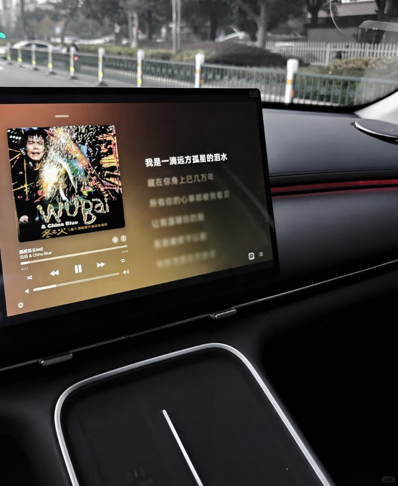

<a id="top"></a>

<p align="center">
  
</p>

<h1 align="center">Zeekr 001 (2023) Apple Music Car · AM++</h1>

<p align="center">
  <strong>让 2023 款极氪 001（8155 / Android 9）拥有真正属于车机大屏的全屏封面与动态流光歌词体验</strong>
</p>

<p align="center">
  <a href="https://github.com/Tai1win10c/Zeekr-001-2023-Apple-Music-Car/releases/tag/preview-08"></a>
  
  
  
  <a href="LICENSE"></a>
</p>

---

> [!IMPORTANT]
> ### 💡 为什么要做这个项目？
> **极氪官方不开发的，我们自己来开发！**
>
> 老款 8155 极氪 001 的车机系统长期停留在 Android 9，许多现代流媒体与大屏视觉体验早已无人维护。虽然我们是“老韭菜”，但**感谢大 AI 时代**，让普通车主也有能力跨越底层逆向与跨版本移植的门槛，亲手把理想中的大屏音乐体验做出来——**让陪伴我们的老车机焕发第二春！**

---

## ✨ 实车双栏与流光歌词效果展示

<p align="center">
  
  &nbsp;&nbsp;
  
</p>

<p align="center">
  <sub>▲ 左：车机大屏展开态「左独立方形封面 + 右原生滚动歌词」实拍参考 &nbsp;|&nbsp; 右：AM++ 横屏双栏与动态色彩背景</sub>
</p>

---

## 🚀 核心亮点：我们在 `preview-08` 实现了什么？

直接往 001 车机里塞一个原版 Apple Music APK，你会遇到**打开即拦截、插网线却报离线、播放页缩在右下角窄条、切歌词就看不见封面**等各种水土不服。我们基于 **AM++** 重新编写了面向 4.9.7.2 宿主的车机适配层，在 **`preview-08`** 带来了四大核心体验升级：

<table>
  <tr>
    <td width="50%" valign="top">
      <h3>🖥️ 1. 真 · 1920×1200 全屏双栏布局</h3>
      <p>彻底解除原版横屏播放器被锁死在右侧 <code>643px</code> 窄栏的限制！点击展开播放页瞬间铺满整个 15.4 英寸中控大屏：</p>
      <ul>
        <li><strong>左栏 44%</strong>：高清独立方形专辑封面 + 进度条 + 原生播放控制</li>
        <li><strong>右栏 56%</strong>：大视野实时同步歌词，收起后丝滑还原回右下角迷你窄栏</li>
      </ul>
    </td>
    <td width="50%" valign="top">
      <h3>🎵 2. 原生逐字动效 · 平滑滚动 · 动态流光背景</h3>
      <p>不是简陋的外挂文本，而是完整激活 Apple Music 原生渲染管线：</p>
      <ul>
        <li>支持<strong>原生卡拉 OK 逐字/逐行高亮动效</strong>与丝滑弹性滚动</li>
        <li>底层 <code>LyricsBackgroundLayerView</code> 随专辑封面实时提取色彩、呈现<strong>动态流光背景</strong></li>
        <li>车机横屏歌词字号专门放大至 <strong><code>36sp</code></strong>，驾驶余光一瞥即清</li>
      </ul>
    </td>
  </tr>
  <tr>
    <td width="50%" valign="top">
      <h3>🖼️ 3. 竖版动态封面遮挡修复（<code>DETAIL_SQUARE</code>）</h3>
      <p>原版遇到带竖版动态视频封面（<code>DETAIL_TALL</code>）的歌曲时，人物画面会直接铺满底层并把左侧方形封面强行隐藏。</p>
      <p>我们在车机横屏模式下精准拦截了这一行为，<strong>强制回退并锁死独立方形封面（<code>DETAIL_SQUARE</code>）</strong>，再也不会出现“左边封面消失、画面糊作一团”的尴尬。</p>
    </td>
    <td width="50%" valign="top">
      <h3>🛡️ 4. 免 Root 独立侧载 + 车机以太网/环境破壁</h3>
      <p>通过 <strong>NPatch</strong> 将适配模块离线内嵌进安装包，无需车机 Root、无需安装任何框架管理器：</p>
      <ul>
        <li><strong>破除 Root 误报</strong>：绕过极氪固件 <code>test-keys</code> 签名触发的原版黑屏拦截页</li>
        <li><strong>打通车载以太网</strong>：修复车机内置网络（Ethernet）被原版判定为“离线”导致首页与在线歌词加载失败的顽疾</li>
      </ul>
    </td>
  </tr>
</table>

### 📊 原版 APK 直装 vs 本项目车机适配版（`preview-08`）

| 体验维度 | 原版 Apple Music 4.9.7.2 直装 | 本项目极氪 001 车机版 (`preview-08`) |
| :--- | :---: | :---: |
| **启动进入主页** | ❌ 识别车机 `test-keys` 直接弹窗拦截 | ✅ **离线补丁绕过检测，秒进主页** |
| **车机蜂窝/以太网在线曲库** | ❌ 误判“你已离线，请接入 Wi-Fi” | ✅ **原生识别车载以太网，曲库与在线歌词秒加载** |
| **播放页展开视野** | ❌ 缩在右侧 643px 窄条，封面歌词二选一 | ✅ **1920×1200 全屏左封面（44%）+ 右歌词（56%）** |
| **原声逐字歌词特效与流光背景** | ⚠️ 仅单栏小字，竖版封面会吞掉专辑框 | ✅ **原生逐字滚动特效 + 流光背景 + 36sp 大字 + 方形封面锁定** |
| **安装门槛** | 需自行折腾权限与签名 | ✅ **免 Root / 免管理器，三条 APK 一键安装** |

---

## 🔮 为什么暂不支持 Liquid Glass / 逐行高斯模糊？（以及 8295 车机展望）

> [!NOTE]
> **这是老 8155 车机底层 Android 9 的物理与系统代差限制，而非我们不想做：**
>
> - **Liquid Glass（液态玻璃底栏）** 与 **双向逐行实时高斯模糊（`RenderEffect`）** 是原版 AM++ 在新款手机/平板上最惊艳的招牌特性。
> - 但这两项能力在底层高度依赖 **Android 12（API 31）的 `RenderEffect` 硬件着色管线** 与 **Android 13+（API 33）的现代图形接口**。
> - 2023 款极氪 001（8155）原生车机底层停留在 **Android 9（API 28）**，系统本身不存在这些渲染 API，强行在旧架构上用 CPU 模拟全屏实时折射与多层模糊会导致严重掉帧。因此我们在 Android 9 上坚持**“能实现的原生特效尽全力榨干，不支持的绝不硬塞拖慢车机”**。

<p align="center">
  
  <br>
  <sub>▲ 原版 AM++ 在高版本系统上的 Liquid Glass 液态玻璃效果演示</sub>
</p>

> [!TIP]
> ### 🚀 如果你的车机是高通 8295 及以上平台（Android 12 / 13+）
> 新一代 **8295 车机**拥有充沛的算力与高版本 Android 系统底座！如果你是 8295 车主并希望在车机上体验完整的 **Liquid Glass 液态玻璃底栏**、**逐行实时高斯模糊歌词** 以及更多新版原生 Apple Music 特性，欢迎提交 Issue 或联系交流——**只要系统底座允许，我完全可以为你进一步开发适配！**

---

## 📦 一分钟快速安装（Preview-08）

1. 前往本仓库 [**Releases (`preview-08`)**](https://github.com/Tai1win10c/Zeekr-001-2023-Apple-Music-Car/releases/tag/preview-08) 下载三个拆分安装包（`base.apk`、`config.arm64_v8a.apk`、`config.xxhdpi.apk`）。
2. 如果车机上装有官方原版签名的 Apple Music，请先卸载原版。
3. 连接车机 ADB，执行同批安装命令：

```sh
adb install-multiple base.apk config.arm64_v8a.apk config.xxhdpi.apk
```

- **试装包签名证书 SHA-256**：`08b00b38cd98762bf261952c2c1014c09208ac2c278fd3085421994a516c3e23`
- **完整实车试装记录与从源码复现指南**：请查阅 [`docs/zeekr-001/AppleMusic-AM++车机API28试装.md`](docs/zeekr-001/AppleMusic-AM++车机API28试装.md)。

---

## 🧩 关于原版 AM++ 与开源致谢

本仓库基于开源项目 [**AM++ (Zennmn/AM-plus-plus)**](https://github.com/Zennmn/AM-plus-plus) 进行车机端定向重编写与适配。原版 AM++ 是一个优秀的 Android 端 Apple Music 增强模块，提供平板横屏双栏、逐行歌词模糊、自定义 TTML 歌词与液态玻璃等特性；本项目在其架构之上补齐了面向 Android 9（API 28）老车机的 `4.9.7.2 (1472)` 宿主适配与离线内嵌构建工具链。

本项目遵循 [GNU General Public License v3.0](LICENSE) 开源，第三方许可声明见 [THIRD_PARTY_NOTICES.md](THIRD_PARTY_NOTICES.md)。衷心感谢以下开源项目与作者：

- [**AM++ (Zennmn/AM-plus-plus)**](https://github.com/Zennmn/AM-plus-plus)：原版模块与架构底座
- [**NPatch**](https://github.com/7723mod/NPatch)：免 Root 应用内嵌加载工具
- [**AMLyricBlur**](https://github.com/a23bc/amlyricblur) / [**AndroidLiquidGlass (Backdrop)**](https://github.com/Kyant0/AndroidLiquidGlass)：原版 AM++ 上游渲染参考与视觉库

---

## ☕ 支持项目

本项目完全免费开源，为每一位还在坚守老 8155 车机的车主用爱发电。如果这个适配版让你的极氪 001 听歌体验焕然一新，欢迎请我喝杯咖啡（赞赏完全自愿，不影响任何功能使用）：

<p align="center">
  <a href="docs/images/zeekr-alipay-support.jpg">
    
  </a>
</p>

<p align="right">(<a href="#top">⬆️ 返回顶部</a>)</p>
